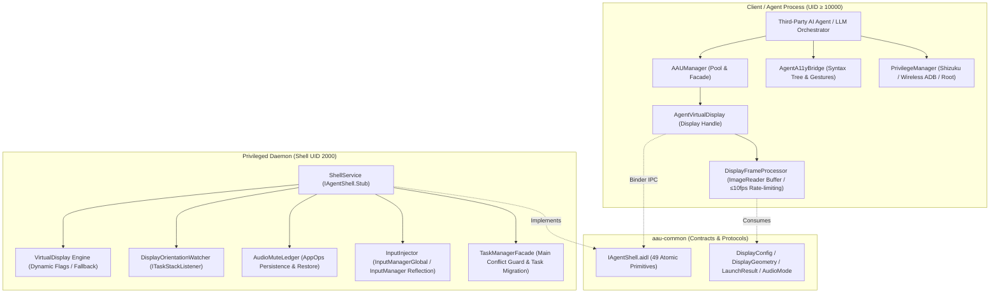

# Android Agent Use (AAU)

<p align="center">
  <strong>A Pure, Non-intrusive, High-performance Android Virtual Display Environment and Automation Toolkit Designed Exclusively for Mobile AI Agents</strong>
</p>

<p align="center">
  <a href="https://github.com/orz-i/Android-Agent-Use/actions"></a>
  <a href="https://github.com/orz-i/Android-Agent-Use/releases"></a>
  <a href="LICENSE"></a>
  <a href="README.md"></a>
</p>

---

## 📖 Table of Contents

- [1. Motivation & Core Value](#1-motivation--core-value)
- [2. Fundamental Comparison: AAU vs scrcpy](#2-fundamental-comparison-aau-vs-scrcpy)
- [3. Architecture Overview](#3-architecture-overview)
- [4. Five Modular Components](#4-five-modular-components)
- [5. Security & Privilege Dropping Design](#5-security--privilege-dropping-design)
- [6. Quick Start & API Usage](#6-quick-start--api-usage)
- [7. Diagnostics & Self-Check](#7-diagnostics--self-check)
- [8. Build & Distribution](#8-build--distribution)
- [9. License](#9-license)

---

## 1. Motivation & Core Value

With the rise of Vision-Language Models (VLMs) and autonomous mobile agents, conventional automation solutions that directly take over the device's main screen suffer from critical limitations:
1. **Severe User Disruption**: Agent operations hijack the user's active screen, causing screen flickering and unwanted keyboard popups while preventing normal phone usage.
2. **Privacy Violations**: Sensitive foreground content (chat messages, banking screens) is exposed to vision captures.
3. **Unexpected Audio Blasts**: E-commerce, short-video, and gaming apps running in the background suddenly play loud audio.
4. **Excessive Resource Drain**: High-framerate video encoding (30~60fps) drains battery rapidly and causes thermal throttling.

**Android Agent Use (AAU)** creates a dedicated, isolated, non-intrusive, and energy-efficient VirtualDisplay environment in the Android system. It allows AI Agents to orchestrate tasks in a parallel background sandbox without any interference with the user's primary screen.

---

## 2. Fundamental Comparison: AAU vs scrcpy

| Dimension | scrcpy (Designed for Human Video Mirroring) | Android Agent Use (Designed for AI Agents) |
| :--- | :--- | :--- |
| **Primary Goal** | High-framerate video mirroring of device screen to PC display | Isolated background sandbox for autonomous AI Agents with 0 user disruption |
| **Display Target** | **Primary Screen (Display 0)** | **Isolated VirtualDisplay** with its own display group |
| **Focus Conflict** | Competes with the human user for main screen focus | **Guaranteed Isolation** via `FLAG_STEAL_TOP_FOCUS_DISABLED` (API 34+) |
| **Virtual Keyboard (IME)** | Pops up soft keyboard on user's main screen | **Local IME Isolation** (`DISPLAY_IME_POLICY_LOCAL=0`), keyboard only in virtual display |
| **Audio Control** | Global audio stream capture or playback; no per-app control | **AppOps Audio Mute** (`PLAY_AUDIO=ignore`), preventing sudden background audio |
| **Image Pipeline** | H.264/H.265/AV1 video stream encoding (30~60fps) | **Direct ImageReader Zero-Copy**, ≤10fps dynamic rate-limiting queue, direct Bitmap/PNG |
| **Main Screen Collision** | Cannot detect collisions; will override active foreground app | **Conflict Avoidance & Pullback**: rejects start if app active on main; pulls back escaping popups |
| **Accessibility Semantics** | Pure video pixels; no semantic view hierarchy | **Integrated a11y Extension** with immutable syntax tree and coordinate/text dual dispatch |
| **Multi-User Support** | Single primary user view | Native support for **Dual Apps / Work Profiles (Cloned Apps)** |

---

## 3. Architecture Overview



---

## 4. Five Modular Components

```
aau-kit (Root)
  ├── aau-common    # Core contracts: AIDL definitions, Parcelables, top-level Kotlin API (AAUManager)
  ├── aau-server    # Shell UID 2000 standalone daemon, builds standalone dex/jar (aau-server.jar)
  ├── aau-client    # Android Library SDK, zero-copy ImageReader pipeline, lifecycle pool & CDP network capture
  ├── aau-a11y      # Optional accessibility extension for semantic tree dump & gestures
  └── aau-setup     # Privilege activation (Shizuku/Wireless ADB/Root) & diagnostic suite (AAUDiagnosticSuite)
```

---

## 5. Security & Privilege Dropping Design

1. **Privilege Dropping (`su 2000 -c`)**:
   - Even on rooted devices, the daemon **never** runs continuously as `root (UID 0)`;
   - Root launch scripts explicitly execute `su 2000 -c app_process ...`, dropping privileges to standard `shell (UID 2000)` to match genuine ADB security boundaries.
2. **Secure Keyguard Credential Channel**:
   - Lock screen credentials (PIN/password) pass solely through in-memory Binder transactions, never written into shell command histories or logcat.
3. **Sensitive Clipboard Isolation**:
   - Clipboard writes enforce `SUPPRESS_CLIPBOARD_OVERLAY` and `EXTRA_IS_SENSITIVE`.
   - Prior user clipboard content is reliably restored upon session completion.
4. **Strict Caller Verification**:
   - Inbound Binder transactions verify caller UIDs to prevent unauthorized cross-app access.

---

## 6. Quick Start & API Usage

### Gradle Dependency
```kotlin
dependencies {
    implementation("com.agent.use:aau-client:0.1.0")
    implementation("com.agent.use:aau-common:0.1.0")
    
    // Optional extensions
    implementation("com.agent.use:aau-a11y:0.1.0")
    implementation("com.agent.use:aau-setup:0.1.0")
}
```

### Virtual Display Lifecycle & Screen Capture
```kotlin
// 1. Initialize manager
val manager = AAUManager.fromBinder(context, shellBinder)

// 2. Create standard 1080P virtual display
val display = manager.createVirtualDisplay(DisplayConfig.standard1080p())

// 3. Collect real-time frames (auto upright rotation, throttled to ≤10fps)
lifecycleScope.launch {
    display.frames.collect { frameBitmap ->
        previewImageView.setImageBitmap(frameBitmap)
    }
}

// 4. Launch app and inject actions
val result = display.startApp("com.example.targetapp")
if (result.isSuccess) {
    display.injectTap(540, 1200)
    display.injectAsciiText("Agent Task Completed")
    display.injectKey(KeyEvent.KEYCODE_ENTER)
}

// 5. Extract screenshots for LLM / OCR inference
val pngBytes: ByteArray? = display.latestPng()
val rawBitmap: Bitmap? = display.latestBitmap() // Caller must recycle

// 6. Graceful finish: stow target app behind main stack, close display
display.finish(keepPackages = listOf("com.example.targetapp"))
```

---

## 7. Diagnostics & Self-Check

```kotlin
val suite = AAUDiagnosticSuite(context, shell)
val report = suite.runFullDiagnostics()

println("Overall Status: ${report.overallStatus}")
println(report.toMarkdown())

// Export sanitized JSON report
val json = report.desensitize().toJson()
```

---

## 8. Build & Distribution

```bash
# Build all modules
./gradlew clean assembleDebug

# Package standalone server jar
./gradlew packageServerDex

# Run all unit and integration tests
./gradlew testDebugUnitTest
```

---

## 9. License

This project is licensed under the [Apache License 2.0](LICENSE).
