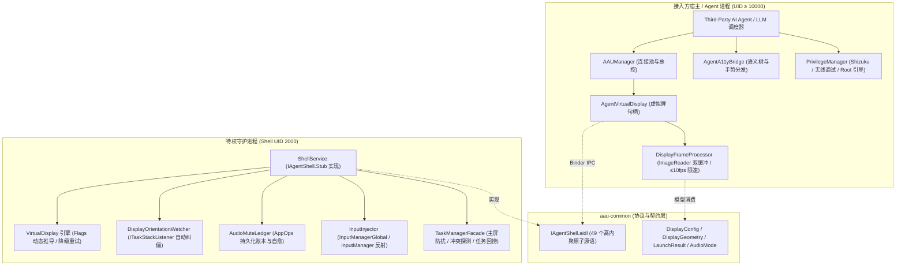

# Android Agent Use (AAU)

<p align="center">
  <strong>专为移动端 AI Agent 打造的纯净、零扰民、高性能 Android 虚拟屏运行环境与自动化控制工具包</strong>
</p>

<p align="center">
  <a href="https://github.com/orz-i/Android-Agent-Use/actions"></a>
  <a href="https://github.com/orz-i/Android-Agent-Use/releases"></a>
  <a href="LICENSE"></a>
  <a href="README.en.md"></a>
</p>

---

## 📖 目录

- [一、项目背景与核心价值](#一项目背景与核心价值)
- [二、与 scrcpy 的本质差异](#二与-scrcpy-的本质差异)
- [三、架构概览](#三架构概览)
- [四、五大模块设计](#四五大模块设计)
- [五、安全与特权降权设计](#五安全与特权降权设计)
- [六、快速开始与 API 用法](#六快速开始与-api-用法)
- [七、环境诊断与自检](#七环境诊断与自检)
- [八、构建与部署](#八构建与部署)
- [九、开源协议](#九开源协议)

---

## 一、项目背景与核心价值

在移动端 AI Agent、视觉语言模型 (VLM) 以及自动化智能体蓬勃发展的今天，传统的自动化方案通常直接操作用户的手机主屏幕。这种方式存在致命缺陷：
1. **严重干扰用户**：Agent 操作时，主屏界面被强行占用，屏幕闪烁、输入法弹出，用户无法正常使用手机；
2. **私密性与安全性缺失**：用户正在处理的微信聊天、银行密码等敏感前台界面随时可能被截屏模型捕获；
3. **后台爆音**：电商应用、短视频或游戏在静默执行时突然大声播放声音；
4. **资源严重浪费**：以 60fps 乃至更高帧率实时编码视频推流，导致移动端发热、电量断崖式下跌。

**Android Agent Use (AAU)** 应运而生。它在 Android 系统底层构建了一套**独立、隔离、无感、低功耗**的 Agent 专用虚拟显示屏 (VirtualDisplay) 运行环境，允许 AI Agent 在后台“平行空间”中全权托管应用，而用户在主屏上的操作丝毫不受影响。

---

## 二、与 scrcpy 的本质差异

很多开发者会问：*“既然已经有成熟的 scrcpy，为什么还需要专门为 Agent 设计 AAU？”*

| 维度 | scrcpy (面向人类投屏交互) | Android Agent Use (专为 AI Agent 设计) |
| :--- | :--- | :--- |
| **设计核心目标** | 将手机当前屏幕画面以高帧率实时镜像推流给人类眼睛观察 | 为 AI 视觉智能体提供独立的后台沙箱，完全不干扰前台用户 |
| **屏幕载体** | **主屏幕 (Display 0)**，直接镜像正在显示的内容 | **独立虚拟屏 (VirtualDisplay)**，自成显示组与独立渲染层 |
| **主屏防干扰** | **无**。屏幕画面、按键和焦点由人类与投屏争抢 | **完全隔离**。通过 `FLAG_STEAL_TOP_FOCUS_DISABLED` 绝不抢主屏焦点 |
| **输入法 (IME)** | 输入框获取焦点时，在用户的主屏幕上弹出虚拟键盘 | **本地化隔离** (`DISPLAY_IME_POLICY_LOCAL=0`)，输入法仅在虚拟屏弹起 |
| **声音处理** | 全局音频转发或外放，无法针对单个后台任务静音 | **AppOps 级别静音** (`PLAY_AUDIO=ignore`)，后台应用绝不爆音，支持安全恢复 |
| **图像消费形态** | H.264/H.265/AV1 视频压缩编码流 (30~60fps) | **ImageReader 零拷贝直读**，≤10fps 动态限速丢帧队列，直接提取 Bitmap/PNG |
| **主屏冲突避让** | 无法感知，容易覆盖用户正在使用的前台 App | **冲突避让与回捞**：主屏在用时拒绝启动，意外溢出弹窗自动调用 `moveTask` 回捞 |
| **语义与无障碍** | 纯像素流，无法获取 Android 语义视图树 | **集成 a11y 插件**，支持不可变语义节点树提取与高精度坐标/文本双重定位 |
| **多用户支持** | 仅按单一主用户展示应用 | 深度支持**分身应用、工作资料 (Dual App / Work Profile)** 的识别与调度 |

---

## 三、架构概览



---

## 四、五大模块设计

AAU 遵循严格的单向依赖与关注点分离原则：

```
aau-kit (Root)
  ├── aau-common    # [核心契约] AIDL 接口定义、Parcelable 数据模型、顶层 Kotlin API 外观 (AAUManager)
  ├── aau-server    # [特权服务端] 运行在 UID 2000 的独立守护进程，产出独立 dex/jar (aau-server.jar)
  ├── aau-client    # [客户端 SDK] 接入方 Android Library，零拷贝直读管线与生命周期池、CDP 原生网络捕获
  ├── aau-a11y      # [可选扩展] 基于 AccessibilityService 的语义树抽取与定向手势
  └── aau-setup     # [特权引导] Shizuku / 无线调试 / Root 引导与全链路诊断套件 (AAUDiagnosticSuite)
```

---

## 五、安全与特权降权设计

由于虚拟屏创建与输入分发依赖特权系统服务，AAU 确立了业界最严苛的安全基线：

1. **绝对降权运行 (`su 2000 -c`)**：
   - 即使设备已取得 Root 权限，守护进程也**绝不**以 `root (UID 0)` 身份长期驻留；
   - 启动命令强制执行 `su 2000 -c app_process ...`，降权至标准 `shell (UID 2000)` 运行，与 ADB 真实上下文严格对齐，规避 Root 滥用风险。
2. **凭据安全通道**：
   - 设备锁屏凭据（PIN/密码）直接经由 Binder 内存传输，**严禁**拼接进 `sh -c` 命令行历史或 logcat 中。
3. **剪贴板防窥与还原**：
   - 写入剪贴板时强制附加 `SUPPRESS_CLIPBOARD_OVERLAY`（禁止弹出系统“已复制”气泡）与 `EXTRA_IS_SENSITIVE`；
   - 任务结束后，系统通过 `restoreClipText` 恢复用户原本的剪贴板内容。
4. **调用方 UID 严格校验**：
   - 服务端拦截所有入站 Binder 事务，校验调用方 UID 与授权包名，拒绝未授权越权调用。

---

## 六、快速开始与 API 用法

### 1. 依赖引入

在项目的 `settings.gradle.kts` 与 `build.gradle.kts` 中添加：

```kotlin
dependencies {
    implementation("com.agent.use:aau-client:0.1.0")
    implementation("com.agent.use:aau-common:0.1.0")
    
    // 可选：无障碍与引导套件
    implementation("com.agent.use:aau-a11y:0.1.0")
    implementation("com.agent.use:aau-setup:0.1.0")
}
```

### 2. 初始化与创建虚拟屏

```kotlin
// 1. 初始化 Manager (支持 Binder 链接与断线监听)
val manager = AAUManager.fromBinder(context, shellBinder)

// 2. 创建一块标准 1080P 虚拟屏
val display = manager.createVirtualDisplay(DisplayConfig.standard1080p())

// 3. 响应式订阅画面流 (反向旋转纠偏，动态限速 ≤10fps)
lifecycleScope.launch {
    display.frames.collect { frameBitmap ->
        previewImageView.setImageBitmap(frameBitmap)
    }
}
```

### 3. 应用调度与输入控制

```kotlin
// 启动目标应用（内置主屏冲突避让，若用户在主屏使用则返回 IN_USE_ON_MAIN）
val result = display.startApp("com.example.targetapp")

if (result.isSuccess) {
    // 注入单击 (逻辑坐标)
    display.injectTap(540, 1200)
    
    // 注入 ASCII 纯文本 (定向直投当前任务输入框)
    display.injectAsciiText("Agent Task Completed")
    
    // 注入按键
    display.injectKey(KeyEvent.KEYCODE_ENTER)
}

// 抽取最新一帧 PNG (直接用于多模态大模型理解)
val pngBytes: ByteArray? = display.latestPng()

// 抽取原始分辨率 Bitmap (供本地 OCR 识别，使用完毕需主动 recycle)
val rawBitmap: Bitmap? = display.latestBitmap()
```

### 4. 任务优雅沉底收尾

```kotlin
// 优雅结束会话：将指定应用沉入主屏任务栈底（保活不弹窗），其余随屏销毁
val finishResult = display.finish(
    keepPackages = listOf("com.example.targetapp"),
    closePackages = emptyList()
)
```

---

## 七、环境诊断与自检

框架内置了全面的自检引擎 `AAUDiagnosticSuite`，可一键评估设备兼容性：

```kotlin
val suite = AAUDiagnosticSuite(context, shell)
val report = suite.runFullDiagnostics()

// 打印自检结论
println("总体状态: ${report.overallStatus}")
println(report.toMarkdown())

// 一键导出脱敏 JSON 诊断报告
val json = report.desensitize().toJson()
```

---

## 八、构建与部署

### 1. 编译全量模块
```bash
./gradlew clean assembleDebug
```

### 2. 打包独立服务端 Jar / Dex
```bash
./gradlew packageServerDex
# 输出路径: aau-server/build/outputs/aau-server.jar
```

### 3. 运行全链路单元测试
```bash
./gradlew testDebugUnitTest
```

---

## 九、开源协议

本项目遵循 [Apache License 2.0](LICENSE) 协议开源。
