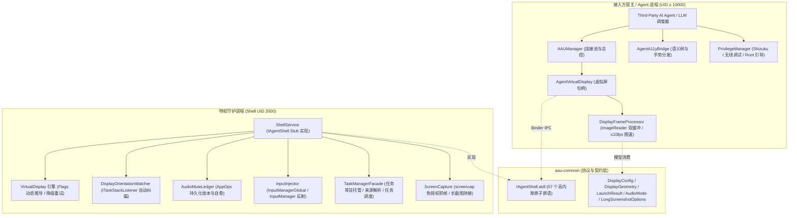

# Android Agent Use (AAU)

<p align="center">
  <strong>专为移动端 AI Agent 打造的纯净、零扰民、高性能 Android 虚拟屏运行环境与自动化控制工具包</strong>
</p>

<p align="center">
  <a href="https://github.com/orz-i/Android-Agent-Use/actions"></a>
  <a href="https://github.com/orz-i/Android-Agent-Use/releases"></a>
  <a href="LICENSE"></a>
  <a href="README.en.md"></a>
</p>

---

## 📖 目录

- [一、项目背景与核心价值](#一项目背景与核心价值)
- [二、与 scrcpy 的本质差异](#二与-scrcpy-的本质差异)
- [三、架构概览](#三架构概览)
- [四、五大模块设计](#四五大模块设计)
- [五、安全与特权降权设计](#五安全与特权降权设计)
- [六、快速开始与 API 用法](#六快速开始与-api-用法)
- [七、环境诊断与自检](#七环境诊断与自检)
- [八、构建与部署](#八构建与部署)
- [九、开源协议](#九开源协议)

---

## 一、项目背景与核心价值

在移动端 AI Agent、视觉语言模型 (VLM) 以及自动化智能体蓬勃发展的今天，传统的自动化方案通常直接操作用户的手机主屏幕。这种方式存在致命缺陷：
1. **严重干扰用户**：Agent 操作时，主屏界面被强行占用，屏幕闪烁、输入法弹出，用户无法正常使用手机；
2. **私密性与安全性缺失**：用户正在处理的微信聊天、银行密码等敏感前台界面随时可能被截屏模型捕获；
3. **后台爆音**：电商应用、短视频或游戏在静默执行时突然大声播放声音；
4. **资源严重浪费**：以 60fps 乃至更高帧率实时编码视频推流，导致移动端发热、电量断崖式下跌。

**Android Agent Use (AAU)** 应运而生。它在 Android 系统底层构建了一套**独立、隔离、无感、低功耗**的 Agent 专用虚拟显示屏 (VirtualDisplay) 运行环境，允许 AI Agent 在后台“平行空间”中全权托管应用，而用户在主屏上的操作丝毫不受影响。

---

## 二、与 scrcpy 的本质差异

很多开发者会问：*“既然已经有成熟的 scrcpy，为什么还需要专门为 Agent 设计 AAU？”*

| 维度 | scrcpy (面向人类投屏交互) | Android Agent Use (专为 AI Agent 设计) |
| :--- | :--- | :--- |
| **设计核心目标** | 将手机当前屏幕画面以高帧率实时镜像推流给人类眼睛观察 | 为 AI 视觉智能体提供独立的后台沙箱，完全不干扰前台用户 |
| **屏幕载体** | **主屏幕 (Display 0)**，直接镜像正在显示的内容 | **独立虚拟屏 (VirtualDisplay)**，自成显示组与独立渲染层 |
| **主屏防干扰** | **无**。屏幕画面、按键和焦点由人类与投屏争抢 | **完全隔离**。通过 `FLAG_STEAL_TOP_FOCUS_DISABLED` 绝不抢主屏焦点 |
| **输入法 (IME)** | 输入框获取焦点时，在用户的主屏幕上弹出虚拟键盘 | **本地化隔离** (`DISPLAY_IME_POLICY_LOCAL=0`)，输入法仅在虚拟屏弹起 |
| **声音处理** | 全局音频转发或外放，无法针对单个后台任务静音 | **AppOps 级别静音** (`PLAY_AUDIO=ignore`)，后台应用绝不爆音，支持安全恢复 |
| **图像消费形态** | H.264/H.265/AV1 视频压缩编码流 (30~60fps) | **ImageReader 零拷贝直读**，≤10fps 动态限速丢帧队列，直接提取 Bitmap/PNG |
| **任务常驻托管** | 无法感知，容易覆盖用户正在使用的前台 App | **常驻托管与来源归因**：主屏在用时避让，`CustodyEngine` 常驻监听任务栈并结合 `LaunchOriginResolver` 精确判定回捞或用户主动切换 |
| **语义与无障碍** | 纯像素流，无法获取 Android 语义视图树 | **集成 a11y 插件**，支持不可变语义节点树提取与高精度坐标/文本双重定位 |
| **多用户支持** | 仅按单一主用户展示应用 | 深度支持**分身应用、工作资料 (Dual App / Work Profile)** 的识别与调度 |

---

## 三、架构概览



---

## 四、五大模块设计

AAU 遵循严格的单向依赖与关注点分离原则：

```
aau-kit (Root)
  ├── aau-common    # [核心契约] AIDL 接口定义、Parcelable 数据模型、顶层 Kotlin API 外观 (AAUManager)
  ├── aau-server    # [特权服务端] 运行在 UID 2000 的独立守护进程，产出独立 dex/jar (aau-server.jar)
  ├── aau-client    # [客户端 SDK] 接入方 Android Library，零拷贝直读管线与生命周期池、CDP 原生网络捕获
  ├── aau-a11y      # [可选扩展] 基于 AccessibilityService 的语义树抽取与定向手势
  └── aau-setup     # [特权引导] Shizuku / 无线调试 / Root 引导与全链路诊断套件 (AAUDiagnosticSuite)
```

---

## 五、安全与特权降权设计

由于虚拟屏创建与输入分发依赖特权系统服务，AAU 确立了业界最严苛的安全基线：

1. **绝对降权运行 (`su 2000 -c`)**：
   - 即使设备已取得 Root 权限，守护进程也**绝不**以 `root (UID 0)` 身份长期驻留；
   - 启动命令强制执行 `su 2000 -c app_process ...`，降权至标准 `shell (UID 2000)` 运行，与 ADB 真实上下文严格对齐，规避 Root 滥用风险。
2. **凭据安全通道**：
   - 设备锁屏凭据（PIN/密码）直接经由 Binder 内存传输，**严禁**拼接进 `sh -c` 命令行历史或 logcat 中。
3. **剪贴板防窥与还原**：
   - 写入剪贴板时强制附加 `SUPPRESS_CLIPBOARD_OVERLAY`（禁止弹出系统“已复制”气泡）与 `EXTRA_IS_SENSITIVE`；
   - 任务结束后，系统通过 `restoreClipText` 恢复用户原本的剪贴板内容。
4. **调用方 UID 严格校验**：
   - 服务端拦截所有入站 Binder 事务，校验调用方 UID 与授权包名，拒绝未授权越权调用。

---

## 六、快速开始与 API 用法

### 1. 依赖引入

在项目的 `settings.gradle.kts` 与 `build.gradle.kts` 中添加：

```kotlin
dependencies {
    implementation("com.agent.use:aau-client:0.1.0")
    implementation("com.agent.use:aau-common:0.1.0")
    
    // 可选：无障碍与引导套件
    implementation("com.agent.use:aau-a11y:0.1.0")
    implementation("com.agent.use:aau-setup:0.1.0")
}
```

### 2. 初始化与创建虚拟屏

```kotlin
// 1. 初始化 Manager (支持 Binder 链接与断线监听)
val manager = AAUManager.fromBinder(context, shellBinder)

// 2. 创建一块标准 1080P 虚拟屏
val display = manager.createVirtualDisplay(DisplayConfig.standard1080p())

// 3. 响应式订阅画面流 (反向旋转纠偏，动态限速 ≤10fps)
lifecycleScope.launch {
    display.frames.collect { frameBitmap ->
        previewImageView.setImageBitmap(frameBitmap)
    }
}
```

### 3. 应用调度与输入控制

```kotlin
// 启动目标应用（内置主屏冲突避让，若用户在主屏使用则返回 IN_USE_ON_MAIN）
val result = display.startApp("com.example.targetapp")

if (result.isSuccess) {
    // 注入单击 (逻辑坐标)
    display.injectTap(540, 1200)
    
    // 注入 ASCII 纯文本 (定向直投当前任务输入框)
    display.injectAsciiText("Agent Task Completed")
    
    // 注入按键
    display.injectKey(KeyEvent.KEYCODE_ENTER)
}

// 抽取最新一帧 PNG (直接用于多模态大模型理解)
val pngBytes: ByteArray? = display.latestPng()

// 抽取原始分辨率 Bitmap (供本地 OCR 识别，使用完毕需主动 recycle)
val rawBitmap: Bitmap? = display.latestBitmap()
```

### 4. 任务优雅沉底收尾

```kotlin
// 优雅结束会话：将指定应用沉入主屏任务栈底（保活不弹窗），其余随屏销毁
val finishResult = display.finish(
    keepPackages = listOf("com.example.targetapp"),
    closePackages = emptyList()
)
```

### 5. 免授权截屏与长截图

AAU 的守护进程运行在 Shell (UID 2000)，因此 `screencap` 对它天然免授权——
**不需要 MediaProjection 的「开始录制」弹窗，也不需要用户开启无障碍**：

```kotlin
// 1. 先看这台设备有哪些通道可用（screencap 路径 / su 提权 / input -d 滚动）
val capability = display.captureCapability()
Log.i(TAG, capability.summary)   // uid=2000 screencap=/system/bin/screencap(ok) root=false ...

// 2. 抓「当下这一刻」的一帧：主屏或任意 display 均可
val png: ByteArray? = display.capturePrivilegedPng()          // 本虚拟屏
val mainPng: ByteArray? = PrivilegedCapture.capturePng(shell, displayId = 0)

// 3. 滚动拼接长截图（同步调用，务必放在工作线程）
val long = display.captureLongScreenshot(
    LongScreenshotOptions.withStickyHeader()   // 排除顶部固定标题栏
)
// long.bitmap 为成品位图，long.meta 里带 frames / scrolls / stop / mode
```

五条通道由 `ScreenCaptureChannel` 按序裁决，任意一条失败自动降级：

| 通道 | 权限代价 | 能力上限 |
|---|---|---|
| `VIRTUAL_DISPLAY` | 无 | 仅自有虚拟屏，取 ImageReader 最后一帧 |
| `SHELL_PRIVILEGED` | 无（守护进程已是 UID 2000） | **任意物理屏，含主屏**，长截图主力 |
| `ROOT_PRIVILEGED` | 需已 Root | Shell 被 OEM 拦截时的兜底，仍抓不到 `FLAG_SECURE` |
| `SECURE_PRIVILEGED` | 无（UID 2000 即可，**不需要 Root**） | **能抓 `FLAG_SECURE` 页面**，Android 17+ |
| `ACCESSIBILITY` | 用户手动开无障碍 | 1 秒系统冷却，仅作最后兜底 |

`SECURE_PRIVILEGED` 不是另一条独立链路，而是 `SHELL_PRIVILEGED` 的升级分支：
`screencap` 抓到纯黑帧时才切过去，普通页面不产生任何额外开销。

#### FLAG_SECURE 页面为什么能抓到

前提是 Android 17 把「要不要放行安全内容」从**隐式屏蔽**改成了**显式策略**：

```java
ScreenCaptureParams params = new ScreenCaptureParams.Builder(displayId)
        .setSecureContentPolicy(SECURE_CONTENT_POLICY_CAPTURE)   // 默认是 REDACT
        .setProtectedContentPolicy(PROTECTED_CONTENT_POLICY_CAPTURE)
        .build();
ScreenCapture.capture(params, executor, receiver);   // 异步，结果里是 HardwareBuffer
```

系统默认走 `REDACT`，也就是 `screencap` 拿到的那片黑。真机上做过对照：
`REDACT` 与 `screencap` 的 PNG **字节数完全相同**（35441），
而 `CAPTURE` 是 148068 且能读出实时时间戳——证明是策略参数在起作用，不是碰巧抓到了别的层。

三个必须处理的实现细节（`SecureCapture.kt` 里都有注释）：

1. `compileSdk = 36` 而 `android.window.ScreenCapture` 是 API 37，**整套调用只能反射**，
   这反而保证了低版本设备上安全退化；
2. 裸 `app_process` 进程里 `ApplicationSharedMemory` 未初始化，`capture()` 会在
   `WindowManagerGlobal.getWindowManagerService()` 抛 `IllegalStateException`。
   解法是反射往 `sWindowManagerService` 私有静态字段塞一个真 WMS 代理；
3. 回调靠 Looper 投递。调用线程若无 Looper 且阻塞等待，进程会被看门狗 SIGKILL
   （只剩一句 `Killed`，没有任何堆栈）。`SecureCapture` 用专用 `HandlerThread` 承载调用。

**边界**：Widevine L1 那类 DRM protected buffer 在 DPU 的安全通路里解密，
非 secure 输出拿不到明文，本通道同样无效。抓到的仍是纯黑时按失败返回，不谎报成功。

#### display id 有两套命名空间，别混用

真机实测（PLK110 / Android 17）踩到的坑，写在这里省得再踩一次：

| 命令 | `-d` 需要的 id | 举例 | 拿不到会怎样 |
|---|---|---|---|
| `screencap -d` | **PhysicalDisplayId**（64 位） | `4630946903293830803` | 传 `0` 报 `Display Id '0' is not valid` |
| `input -d` | 逻辑 display id（小整数） | `0` | 静默无效 |

物理 id 从 `dumpsys SurfaceFlinger --display-id` 解析（`Display <physical> (HWC display <n>)`），
引擎内部做了缓存与换算。两条实用结论：

- **主屏一律不传 `-d`**：`screencap` 默认就抓默认物理屏，这是跨版本最稳的路径；
- **虚拟屏抓不到**：它没有物理端口，不出现在那份列表里。硬传逻辑 id 只会失败，所以引擎让
  `capturePng` 在解析不到物理 id 时**明确失败**，绝不退化成「抓主屏返回给你」。虚拟屏仍然走
  `VIRTUAL_DISPLAY`（ImageReader）。

#### 长截图不是「录屏抽帧」，也不是 KMP

真实流程是**滚动 → 等高稳定 → 锚点投票求位移 → 只拼增量行**。

算法经过两次真机纠正，值得记下来：

1. **KMP 精确匹配不可用**。实测一次滚动的两帧只有约 97.8% 的行逐像素相同，其余因抗锯齿、
   亚像素位移、OLED 调光差一两个色阶；精确匹配要求 100% 连续相等，直接归零。
2. **「粗扫 + 局部精修」也不可用**。真实位移不落在粗扫步长上时，相邻候选点的分数全是噪声级，
   谷底只有一两行宽，粗扫看不见它。
3. **锚点投票才对**。从新帧挑高纹理行当锚点，各自在旧帧里找最像的位置，对 `delta = j - i`
   投票，票数最高的几个再用整段加权距离复核。单行即可定位，不依赖连续匹配。

配套的三个工程细节：

- **纯色行必须降权**：整屏黑底会让任意位移都拿到接近 0 的分数，不加权就会把「没滚动」当成「完全重叠」；
- **滚动量要留足重叠**：`input swipe` 的 fling 惯性会把实际位移推到手势距离的 1.5~1.8 倍
  （1275px 的手势滚了 2273px），默认值压到 30% 屏高 + 900ms 慢速手势；
- **首帧可能要丢弃**：可折叠大标题在第一次滚动时收起，内容原点整体上移一两百像素，两帧不再是
  纯垂直平移关系。此时以稳定后的帧为新起点重启拼接（`LongScreenshotStitcher.reset()`），
  比硬拼出一张错位图正确。

终止原因是分开的：滚到底（`REACHED_END`）、页面跳转（`NO_OVERLAP`）、撞高度上限（`MAX_HEIGHT`）、
手势无效（`NO_PROGRESS`），原样带回客户端。

真机实测（设置页）：4 帧拼成 1272×6147，从「飞行模式」到「帮助与反馈」共 24 个条目完整无重复、
无跳过，耗时约 13.6s。样本见 [`docs/capture/longshot-settings-6147px.png`](docs/capture/longshot-settings-6147px.png)，
同目录下还有滚动前后的单帧对照。

设备侧自检（与引擎内部调用等价）：

```bash
adb exec-out screencap -p > main.png                       # 免授权抓主屏，等价于 capturePng(0)
adb shell dumpsys SurfaceFlinger --display-id              # 看物理 display id（screencap -d 用这个）
adb shell input 2>&1 | head -3                             # 看 usage 里是否有 -d，长截图滚动依赖它
adb shell su -c id -u                                      # 输出 0 表示 Root 通道可用
```

两个**能力边界**需要提前知道：`FLAG_SECURE` 页面在 Android 17+ 已能经 `SECURE_PRIVILEGED`
通道抓到（见上），剩余的硬边界是 DRM protected buffer——Widevine L1 那类内容在 DPU 安全通路里
解密，任何非 secure 输出都拿不到明文，此时引擎按失败返回原因，而不是给上层一张看似成功的黑图；
`input -d` 驱动的是真实手势，对主屏做长截图时用户会看到页面在滚动。

---

## 七、环境诊断与自检

框架内置了全面的自检引擎 `AAUDiagnosticSuite`，可一键评估设备兼容性：

```kotlin
val suite = AAUDiagnosticSuite(context, shell)
val report = suite.runFullDiagnostics()

// 打印自检结论
println("总体状态: ${report.overallStatus}")
println(report.toMarkdown())

// 一键导出脱敏 JSON 诊断报告
val json = report.desensitize().toJson()
```

---

## 八、构建与部署

### 1. 编译全量模块
```bash
./gradlew clean assembleDebug
```

### 2. 打包独立服务端 Jar / Dex
```bash
./gradlew packageServerDex
# 输出: aau-server/build/outputs/aau-server.jar
#       aau-server/build/outputs/classes.dex
#       aau-server/build/outputs/native/arm64-v8a/libLiteRt.so
```

jar 里只有 dex。LiteRT 的原生库要单独部署：裸 `app_process` 进程没有 `nativeLibraryDir`，
`System.loadLibrary` 只找 `/system/lib64`，所以守护进程启动时按绝对路径 `System.load`
（见 `aau-server` 的 `NativeLibraries`）。库放在 jar 同级的 `lib/`，或下面的默认位置：

```bash
adb push aau-server/build/outputs/aau-server.jar /data/local/tmp/
adb push aau-server/build/outputs/native/arm64-v8a/libLiteRt.so /data/local/tmp/aau/lib/
```

需要端上实体识别时再放模型（资产不入库，生成方式见 `aau-ner/README.md`）：

```bash
adb push aau-ner/src/main/assets/aau_ner_v1.* /data/local/tmp/ner/
adb shell "CLASSPATH=/data/local/tmp/aau-server.jar app_process /system/bin \
  com.agent.use.server.NerSelfCheck /data/local/tmp/ner"
```

### 3. 运行全链路单元测试
```bash
./gradlew testDebugUnitTest
```

---

## 九、开源协议

本项目遵循 [Apache License 2.0](LICENSE) 协议开源。
